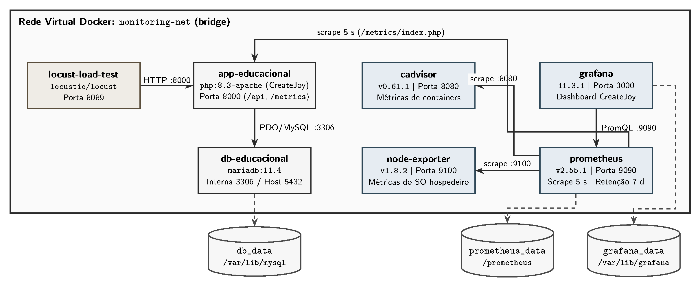

# Observabilidade e Monitoramento de Recursos do SO com Containers

Trabalho Prático da disciplina **Sistemas Operacionais Modernos** (CEFET-MG / UFCI-MG, Departamento de Computação — Prof. Michel Pires da Silva).  
**Trilha:** Prática 2 — Observabilidade e Monitoramento de Recursos do SO.

## Integrantes

- Igor Moreira Lopes
- Lívia Gonçalves
- Arthur de Oliveira Mendonça
- Maria Eduarda Alves Barbosa
- Lorena Ávila de Souza Silva
- Gustavo Henrique D'Anunciação Ferreira

---

## Visão Geral

O projeto implementa uma pilha completa de observabilidade orquestrada via **Docker Compose** para monitorar métricas do sistema operacional hospedeiro e de containers (**CPU, Memória RAM, I/O de disco e Tráfego de rede**) utilizando **Prometheus, Grafana, cAdvisor e Node Exporter**.

Como sistema alvo, utiliza-se uma instância local da plataforma educacional **CreateJoy** (PHP 8.3/Apache + MariaDB 11.4 populado com dados fictícios), submetida a testes de carga concorrente em Python (**Locust**) com:
- **Cenário 1 (`load-tests/locust_alunos.py`):** 10, 50 e 100 alunos simultâneos realizando login, consultas ao painel/catálogo e solicitações na loja.
- **Cenário 2 (`load-tests/locust_atividades.py`):** 20 alunos simultâneos enviando atividades com arquivos `.ino` de **1 KB**, **100 KB** e **5 MB**.

---

## Arquitetura



Todos os serviços comunicam-se na rede bridge `monitoring-net` com persistência em três volumes nomeados (`db_data`, `prometheus_data` e `grafana_data`):

| Serviço | Imagem / Build | Porta (Host:Container) | Função |
| :--- | :--- | :--- | :--- |
| `app` (`app-educacional`) | `php:8.3-apache` (`./app`) | `8000:8000` | Plataforma CreateJoy e endpoint `/metrics/index.php` |
| `db` (`db-educacional`) | `mariadb:11.4` | `5432:3306` | Banco relacional inicializado com esquema e dados fictícios |
| `cadvisor` | `ghcr.io/google/cadvisor:v0.61.1` | `8080:8080` | Coleta de CPU, RAM, disco e rede por container |
| `node-exporter` | `prom/node-exporter:v1.8.2` | `9100:9100` | Coleta de métricas de hardware e núcleo do SO hospedeiro |
| `prometheus` | `prom/prometheus:v2.55.1` | `9090:9090` | Armazenamento de séries temporais (coleta `5s`, retenção `7d`) |
| `grafana` | `grafana/grafana:11.3.1` | `3000:3000` | Dashboard *Observabilidade CreateJoy* provisionado via código |
| `locust` (`locust-load-test`) | `locustio/locust:latest` | `8089:8089` | Geração de carga concorrente em Python contra `http://app:8000` |

---

## Estrutura do Repositório

```text
.
├── app/                         # Código-fonte, Dockerfile, migrações SQL, seed e app/ROTAS.md
├── docs/                        # Enunciado do trabalho prático (pratica-1.pdf)
├── grafana/provisioning/        # Datasource Prometheus e dashboard observabilidade-so.json
├── load-tests/                  # Scripts Locust (locust_alunos.py e locust_atividades.py)
├── monitoramento/               # Guia detalhado (README.md) e script coletar_evidencias.sh
├── prometheus/                  # Configuração de scraping (prometheus.yml)
├── relatorio/                   # Artigo IEEE em LaTeX (main.tex), PDF (main.pdf), imagens e evidências
├── docker-compose.yml           # Orquestração completa dos 7 containers, rede e volumes
└── .env.example                 # Modelo de variáveis de ambiente locais
```

---

## Como Executar

1. **(Opcional) Criar o arquivo `.env` local:**
   ```bash
   cp .env.example .env
   ```

2. **Subir todos os containers:**
   ```bash
   docker compose up -d --build
   docker compose ps
   ```

3. **Acessar as interfaces:**
   - **CreateJoy:** `http://localhost:8000` (conta aluno: `aluno.demo@createjoy.local` / `Admin@123`; demais contas em `app/ROTAS.md`)
   - **Prometheus (Targets):** `http://localhost:9090/targets`
   - **Grafana (Dashboard *Observabilidade CreateJoy*):** `http://localhost:3000` (`admin` / `Create123`)
   - **Locust (Interface Web):** `http://localhost:8089`

4. **Executar os testes de carga:**
   - **Via interface web:** acesse `http://localhost:8089` (carrega `locust_alunos.py` por padrão).
   - **Alternar para `locust_atividades.py` em modo *headless*:**
     ```bash
     docker compose run --rm --no-deps -e TAMANHO_ENTRADA=grande locust \
       -f /mnt/locust/locust_atividades.py --host=http://app:8000 \
       --headless -u 20 -r 4 -t 45s
     ```
   - **Bateria completa automatizada:** `./monitoramento/coletar_evidencias.sh`

5. **Encerrar o ambiente (preservando volumes):**
   ```bash
   docker compose down
   ```

Para instruções detalhadas de instalação no Windows/WSL 2 e interpretação das métricas, consulte [`monitoramento/README.md`](monitoramento/README.md).

---

## Relatório Técnico e Resultados

O artigo técnico completo no formato **IEEE Conference** está disponível em [`relatorio/main.pdf`](relatorio/main.pdf) (código-fonte em [`relatorio/main.tex`](relatorio/main.tex)), acompanhado das evidências brutas em [`relatorio/evidencias/`](relatorio/evidencias/).

| Cenário | Usuários | Req. (Falhas) | CPU Host (%) | CPU App / DB (%) | RAM App / DB (MiB) | Escrita App / Host | p50 / p95 (ms) |
| :--- | :---: | :---: | :---: | :---: | :---: | :---: | :---: |
| Ocioso (Baseline) | 0 | N/A | 12,33 | 0,29 / 0,88 | 20,26 / 119,56 | 0 B/s / 590 KB/s | N/A |
| Alunos e Loja (Baixa) | 10 | 268 (0,00%) | 13,63 | 3,20 / 4,63 | 39,03 / 129,27 | 0,8 KB/s / 2,78 MB/s | 12 / 59 |
| Alunos e Loja (Média) | 50 | 1.321 (0,00%) | 16,49 | 14,53 / 18,15 | 99,75 / 154,88 | 4,5 KB/s / 4,46 MB/s | 12 / 25 |
| Alunos e Loja (Alta) | 100 | 3.380 (0,00%) | 24,55 | 32,46 / 43,65 | 175,87 / 185,57 | 7,6 KB/s / 3,75 MB/s | 12 / 34 |
| Atividades (1 KB) | 20 | 255 (2,75%) | 19,29 | 19,07 / 32,26 | 145,89 / 232,82 | 18,3 KB/s / 2,96 MB/s | 93 / 1.500 |
| Atividades (100 KB) | 20 | 192 (0,52%) | 15,38 | 7,79 / 7,26 | 114,23 / 263,07 | 20,3 KB/s / 3,11 MB/s | 72 / 330 |
| Atividades (5 MB) | 20 | 131 (3,05%) | 19,54 | 10,80 / 6,95 | 102,31 / 266,01 | 3,57 MB/s / 6,43 MB/s | 130 / 470 |
